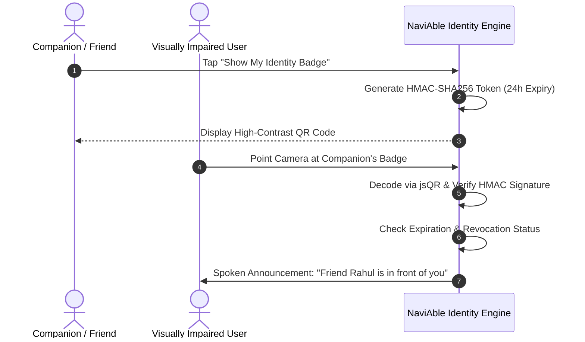

# NaviAble AI — People Memory, Consent Architecture & Biometric Privacy Policy

**Policy:** Absolute Zero Biometrics & Voluntary Consent-Based Identity Sharing  
**Date:** November 1, 2026  
**Implementation Files:** `src/services/IdentityTokenService.ts`, `src/remember/PeopleMemory.ts`, `src/pages/RememberPage.tsx`  

---

## 1. Absolute Ethical Boundary: Zero Biometrics

> [!IMPORTANT]
> **Core Privacy Guarantee:**
> NaviAble AI does **NOT** use, capture, calculate, store, or transmit facial recognition models, facial embeddings, landmark geometry vectors, or biometric templates of any human being.
> 
> Unconsented facial identification of people in public is an invasive surveillance practice that violates personal dignity, poses severe stalker/harassment risks, and breaches modern privacy laws worldwide (including the **Indian Digital Personal Data Protection Act (DPDPA) 2023**, the **European GDPR Article 9**, and California CCPA).

---

## 2. The Solution: Consent-Based Voluntary Identity Badges

In real life, visually impaired individuals interact with trusted individuals: family members, friends, caregivers, doctors, teachers, and colleagues. Recognition should occur only when both parties consent.

NaviAble implements **Sovereign Voluntary Identity Badges**:
1. When a friend or companion wishes to identify themselves to the user, they open their NaviAble app or web link and tap **"Show My Identity Badge"**.
2. A high-contrast QR digital badge is generated on their screen.
3. The badge is cryptographically signed using HMAC-SHA256 and contains an explicit expiration timestamp (e.g. 24 hours or 7 days).
4. The visually impaired user's camera scans the QR badge using `jsQR`.
5. Once verified, the companion's profile (name, nickname, relationship) is saved into the user's private on-device People Memory.
6. When the badge is detected in front of the camera, Navi announces: *"Friend Rahul is in front of you."*



---

## 3. Cryptographic Token Structure

The identity token follows a signed format: `NAVI_ID:v1:<base64url_json_payload>.<signature_hex>`

### Payload Schema:
```json
{
  "v": 1,
  "id": "id_m8b3k2q1",
  "name": "Rahul Sharma",
  "nick": "Rahul",
  "rel": "Friend",
  "iat": 1730419200000,
  "exp": 1730505600000,
  "owner": "user_rahul"
}
```

### Security Measures:
- **Tamper Resistance:** Any change to the name, relationship, or expiry invalidates the HMAC signature and causes immediate rejection.
- **Auto-Expiration:** Badges expire automatically after the specified validity window (default 24h), preventing long-term replay by unauthorized parties.
- **One-Tap Revocation:** The issuer can revoke an issued token at any time through their dashboard.
- **Zero Cloud Leakage:** Badges are stored locally in IndexedDB. No centralized biometrics registry exists.

---

## 4. Quiet Public Announcement Mode

In crowded public spaces (e.g. metro stations, city buses, crowded streets), loudly announcing a person's name (*"Dr. Mehta is in front of you"*) can compromise the personal safety and privacy of both the user and the contact.

NaviAble provides a dedicated **Quiet Public Announcement Mode**:
- **Disabled (Home / Private Mode):** Announces full name and relationship: *"Family Priya is in front of you."*
- **Enabled (Public Mode):**
  - Suppresses broadcasting the person's name aloud to surrounding strangers.
  - Speaks a discreet generic confirmation: *"Verified contact detected nearby."*
  - Provides a soft haptic buzz / vibration pattern on supported mobile devices.

---

## 5. Regulatory Compliance Matrix

| Regulation | Requirement | NaviAble Implementation |
|---|---|---|
| **India DPDPA 2023** | Explicit consent for personal data processing | Opt-in QR presentation by the contact |
| **EU GDPR Art. 9** | Prohibition of biometric data processing without explicit consent | Zero face vectors or facial recognition models used |
| **California CCPA/CPRA** | Right to delete & limit use of sensitive personal info | Immediate client-side revocation & deletion in 1 tap |
| **UN Convention (CRPD)** | Accessible assistive technology respecting human autonomy | High-contrast UI, screen-reader compatibility, non-intrusive |
