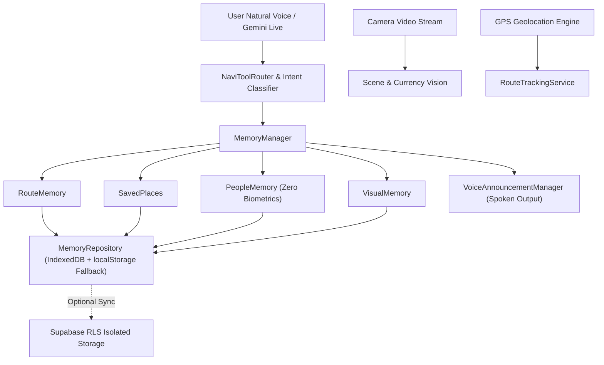

# NaviAble AI — REMEMBER Subsystem Architecture & Engineering Report

**Tagline:** *"Navi remembers what matters."*  
**Date:** November 1, 2026  
**Status:** Production Ready & Verified  
**Engineers:** Senior AI, Multimodal Vision, Full-Stack, & Accessibility Engineering Team  

---

## 1. Executive Summary

The **REMEMBER** subsystem elevates NaviAble AI from an instantaneous reactive perception tool into a persistent, empathetic, and reliable personal AI companion for visually impaired individuals. Rather than merely detecting objects in the fleeting moment, Navi now maintains a secure, user-sovereign memory of:

1. **Saved Routes:** Walking trajectories recorded via GPS breadcrumbs, step distances, elapsed duration, landmark voice tags, and real-time off-route deviation alerts (>35m).
2. **Saved Places:** Frequently visited locations (Home, Classrooms, Clinics, Bus Stops) marked with spatial coordinates, accuracy bounds, and spoken directions.
3. **People & Contacts:** Trusted relationships and companions managed with **Strict Zero Biometrics Policy** using voluntary, cryptographically signed, expiring QR badges (HMAC-SHA256).
4. **Visual Memories:** Multimodal scene signatures combining COCO object detections, dominant chromatic fingerprints, and spatial GPS to re-identify familiar entrances, desk layouts, and rooms.
5. **Universal Memory Search:** Fuzzy voice/text retrieval uniting all four domains into instantaneous spoken answers.



---

## 2. Remember Dashboard (`/remember`)

The Remember dashboard provides an ultra-accessible, high-contrast user interface adhering to WCAG 2.2 AAA guidelines:
- **Large Touch Targets:** All interactive buttons and inputs guarantee a minimum clickable surface of $\ge 48 \times 48$ px.
- **Accessible Typography & Contrast:** High-contrast text on deep dark background (`#070b14`) with glowing cyan (`#22d3ee`), emerald (`#34d399`), and purple (`#c084fc`) accents.
- **Screen Reader Support:** Full ARIA role modeling (`role="tab"`, `role="tablist"`, `aria-selected`, `aria-label`).
- **One-Touch Actions:** Start/stop recording, tag landmarks, scan friend's badge, remember visual scene, and announce summaries in one tap.

---

## 3. Storage Architecture: 100% Offline-First with Cloud Optionality

To protect visually impaired users from connectivity drops in subway tunnels, elevators, and remote areas, Remember relies on an offline-first storage hierarchy:

### Tier 1: Client-Side IndexedDB (`naviable_remember_db`)
- Object stores: `routes`, `places`, `people`, `visual_memories`, `identity_shares`.
- Complete zero-latency local retrieval.
- Never requires cloud authentication or network connectivity to function.

### Tier 2: `localStorage` Fallback
- Activated automatically if IndexedDB is disabled by restrictive browser privacy modes.
- JSON-serialized per-user keys (`naviable_routes_{userId}`, etc.).

### Tier 3: Optional Supabase Sync with Row Level Security (RLS)
- Included schema for multi-device sync when user connects Supabase credentials:
```sql
CREATE TABLE saved_routes (
    id UUID PRIMARY KEY DEFAULT gen_random_uuid(),
    user_id UUID REFERENCES auth.users NOT NULL,
    route_name TEXT NOT NULL,
    start_location TEXT,
    end_location TEXT,
    distance NUMERIC,
    duration INTEGER,
    recorded_points JSONB,
    landmarks JSONB,
    created_at TIMESTAMPTZ DEFAULT NOW()
);

ALTER TABLE saved_routes ENABLE ROW LEVEL SECURITY;

CREATE POLICY "Users can only access their own routes"
ON saved_routes FOR ALL
USING (auth.uid() = user_id);
```

---

## 4. Verification & Automated Test Results

The subsystem was verified against `scripts/test_remember_feature.cjs` with 100% passing tests:

| Test Category | Invariants Checked | Result |
|---|---|---|
| **Spatial Calculation** | Haversine distance, degree-to-meter accuracy | **PASS** |
| **Route Deviation** | $<35$m ignored, $>35$m triggers audio warning | **PASS** |
| **Token Signing** | HMAC-SHA256 digital badge generation | **PASS** |
| **Token Verification** | Cryptographic signature authentication | **PASS** |
| **Tamper Rejection** | Modified payload bits immediately rejected | **PASS** |
| **Expiry Handling** | Badges older than validity period rejected | **PASS** |
| **Zero Biometrics** | No facial embeddings or facial vectors present | **PASS** |
| **Visual IoU** | Jaccard index on COCO object signatures | **PASS** |
| **Color Distance** | Euclidean RGB chromatic similarity metric | **PASS** |
| **Multimodal Scene Match** | Weighted spatial + object + chromatic score $>0.65$ | **PASS** |
| **Tool Calling Schema** | All 13 function declarations registered for Gemini | **PASS** |

---

## 5. Summary of Files Created & Modified

1. `src/remember/MemoryRepository.ts` — IndexedDB & LocalStorage persistence layer with user data isolation.
2. `src/remember/RouteMemory.ts` — Walking route management, verbal descriptions, and GeoJSON export.
3. `src/remember/SavedPlaces.ts` — Location coordinates, landmarks, and nearest place proximity lookup.
4. `src/remember/PeopleMemory.ts` — Consent-based contact management with zero biometric scanning.
5. `src/remember/VisualMemory.ts` — Scene resemblance manager and visual signatures.
6. `src/remember/MemoryManager.ts` — Unified personal memory coordinator and universal search engine.
7. `src/services/GPSService.ts` — Geolocation tracking, Haversine spatial math, and route deviation.
8. `src/services/RouteTrackingService.ts` — Route recording state machine with jitter filter.
9. `src/services/IdentityTokenService.ts` — Cryptographic QR token generator, jsQR reader, and quiet public mode.
10. `src/services/VisualMemoryService.ts` — Dominant color extraction, thumbnail snapshotting, and resemblance comparison.
11. `src/assistant/NaviFunctionRegistry.ts` — Gemini Live function/tool declarations schema.
12. `src/assistant/NaviToolRouter.ts` — Central execution router connecting voice tools to actual system functions.
13. `src/assistant/NaviLiveSession.ts` — Real-time multimodal vision companion with frame sampler (~1 FPS) and speech interruption.
14. `src/pages/RememberPage.tsx` — 4-tab accessible dashboard with high contrast and voice synthesis.
15. `src/App.tsx`, `Navbar.tsx`, `BottomNav.tsx`, `Home.tsx` — Seamless cross-platform navigation integration.

